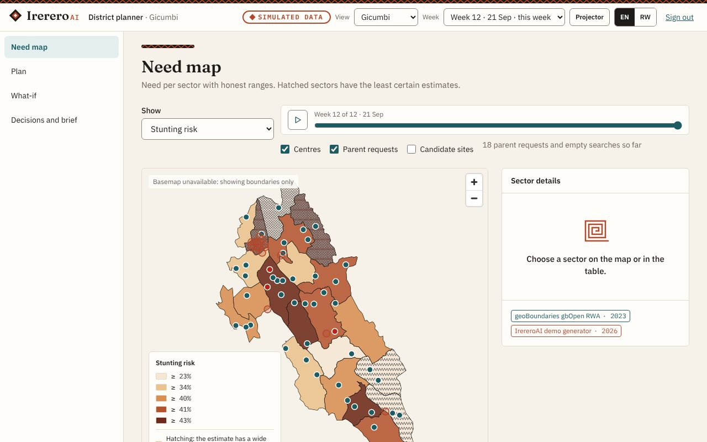
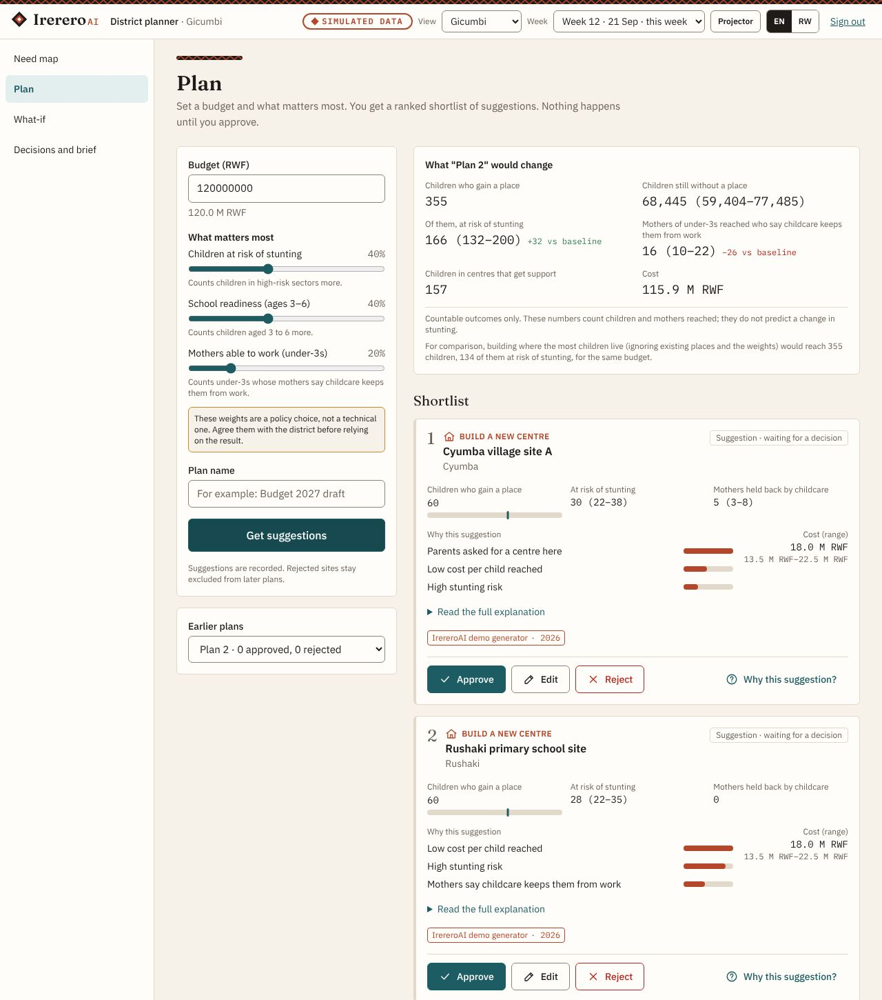
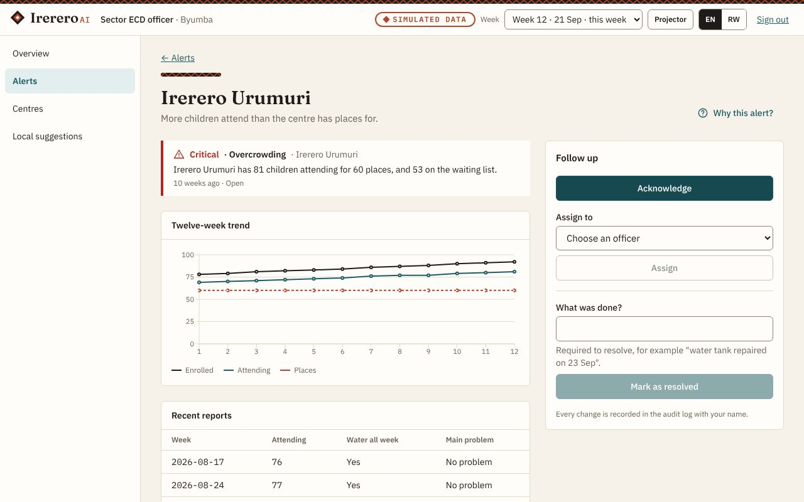
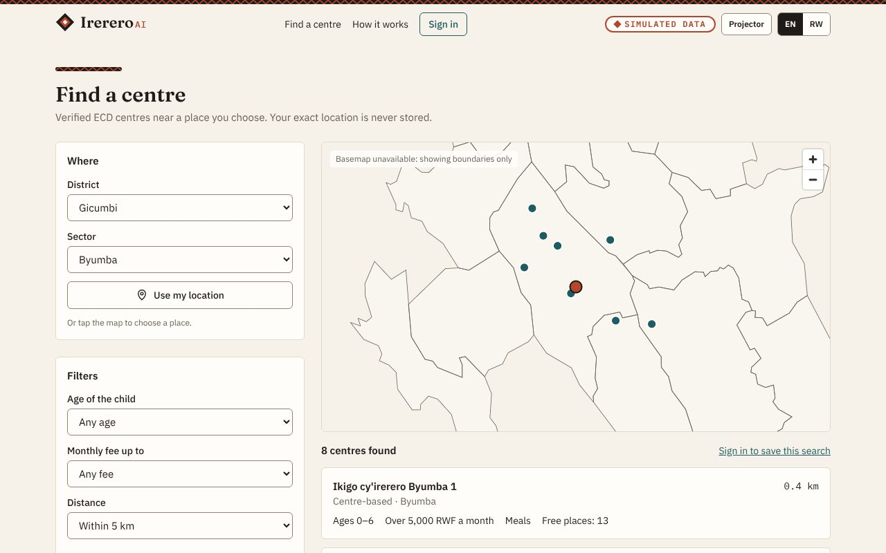
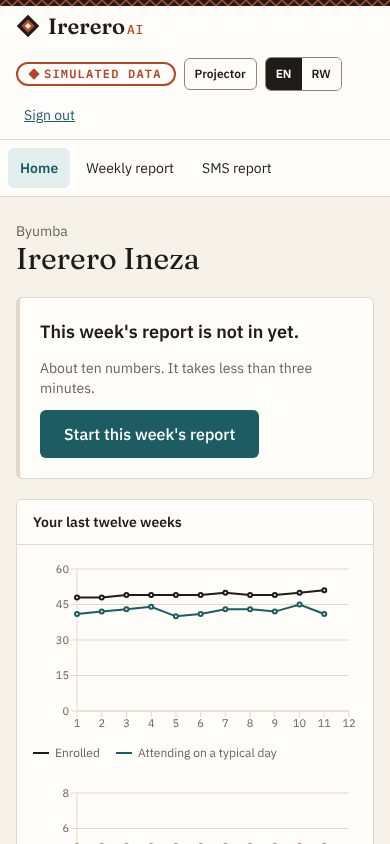

# IrereroAI

Decision support for early childhood development (ECD) in Rwanda, built for the NISR 2026 Big
Data Hackathon, Track 3.

Rwanda's NST2 aims to raise pre-primary enrolment from 35% to 65% and bring under-5 stunting
below 15% by 2029. In Gicumbi, RDHS 2025 puts stunting at 38.8%. Districts have to decide where to
open and support ECD centres, with uneven data. IrereroAI turns that into one loop:

- **Plan.** Planners see need per sector with honest ranges, and get a ranked shortlist of
  sites and support actions within their budget, each with its reasons, range and sources.
- **Track.** Caregivers send a weekly report in under three minutes, on a smartphone (it works
  offline) or by coded SMS. Sector officers get early-warning alerts and follow them up.
- **Find.** Parents find verified centres near them. A search with no result is counted as
  demand, without storing where the parent is.
- **Learn.** Every approval, edit and rejection is recorded with its reason, and shapes the next
  plan.

AI suggests, people decide. Nothing runs without a person approving it, and every decision is in
an append-only audit log.

## Data honesty

**Everything in the demo is simulated except the boundaries and the published figures above.**
The province, district and sector shapes come from geoBoundaries (CC BY 4.0, from NISR open
data). Centres, reports, estimates, costs, sites and parent requests are generated for Gicumbi by
a deterministic script and stored with `origin = simulated`. Any screen showing such data carries
a SIMULATED DATA label. No NISR microdata is in this repository; Phase 2 loads it through
adapters that are already specified ([docs/PHASE2_SOURCES.md](docs/PHASE2_SOURCES.md)).

The platform holds counts and areas only. It never stores records about an individual child,
and it stores parent locations only as 500 m grid cells. Public pages withhold any count below 5.
See [docs/PRIVACY.md](docs/PRIVACY.md).

## Screenshots

All taken from the seeded demo, so all data shown is simulated.

| | |
| --- | --- |
|  |  |
| **Need map.** Hatching marks the least certain estimates. | **Plan.** Every suggestion shows why, how sure, and its source. |
|  |  |
| **Alert.** Officers acknowledge, assign and resolve, all audited. | **Find.** Verified centres only; small counts withheld. |



**Caregiver home** on a phone, with the weekly report one tap away.

## Run locally

Requirements: Docker with Compose.

```sh
docker compose up --build -d
make seed       # downloads the boundaries, then builds the simulated Gicumbi demo
```

Open <http://localhost:3000> and start the five-minute tour at
<http://localhost:3000/tour>. The API docs are at <http://localhost:8000/docs>.

### Development without Docker

Requirements: Python 3.12 with [uv](https://docs.astral.sh/uv/), Node 22 with pnpm, and
PostgreSQL 16 with PostGIS.

```sh
cp .env.example .env
make setup      # dependencies and git hooks
make migrate
make seed-local
make api        # http://localhost:8000
make web        # http://localhost:3000
```

Checks: `make lint`, `make typecheck`, `make test`. With the stack running and freshly seeded,
`make e2e` runs the demo journeys and the accessibility checks in a browser. They change data, so
reseed afterwards.

## Demo accounts

These exist only in demo mode, and the sign-in page offers each one with a single tap. All staff
accounts share the password `irerero-demo-2026`. <!-- pragma: allowlist secret -->

| Role | Sign in with | Sees |
| --- | --- | --- |
| Parent | Phone 0700 000 001; the one-time code shows on screen | Find, saved searches |
| Caregiver | Phone 0700 000 002, centre code `ECD-GIC-001` | Irerero Ineza only |
| Sector ECD officer | `officer.byumba@demo.irereroai.rw` | Byumba sector |
| District planner | `planner.gicumbi@demo.irereroai.rw` | Gicumbi district |
| National analyst | `analyst@demo.irereroai.rw` | All districts |
| System admin | `admin@demo.irereroai.rw` with the six-digit code shown on the sign-in page | Users, pipelines, audit log |

## Documentation

| Document | Contents |
| --- | --- |
| [ARCHITECTURE.md](docs/ARCHITECTURE.md) | Packages, data flow, engine interfaces, API and web design, tests |
| [DATA_CONTRACT.md](docs/DATA_CONTRACT.md) | Every table and column (generated) |
| [PRIVACY.md](docs/PRIVACY.md) | Personal data, Law No. 058/2021, go-live checklist |
| [PHASE2_HANDOFF.md](docs/PHASE2_HANDOFF.md) | Loading real sources and replacing the baselines |
| [PHASE2_SOURCES.md](docs/PHASE2_SOURCES.md) | Each source's files, checks and target tables (generated) |
| [DEPLOYMENT.md](docs/DEPLOYMENT.md) | Hosted demo on Vercel with managed PostGIS; turning demo mode off |
| [DESIGN_SYSTEM.md](docs/DESIGN_SYSTEM.md) | Tokens, components and design rules |
| [i18n-review.md](docs/i18n-review.md) | Kinyarwanda strings awaiting native-speaker review (generated) |

## Repository

| Path | Contents |
| --- | --- |
| `apps/api` | FastAPI service |
| `apps/web` | Next.js web app |
| `packages/contract` | Data contract: tables, record models, code lists |
| `packages/engine` | Explainable decision-support baselines |
| `pipelines` | Source adapters and the demo data generator |
| `data` | Gitignored except the README and JSON Schemas |

## Team

Contact: fabricetuyishime2050@gmail.com

All rights reserved. This repository is private.
